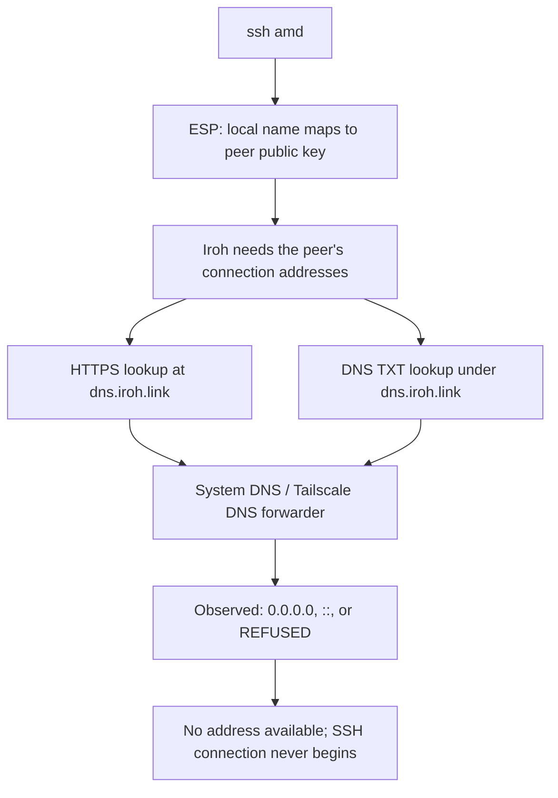
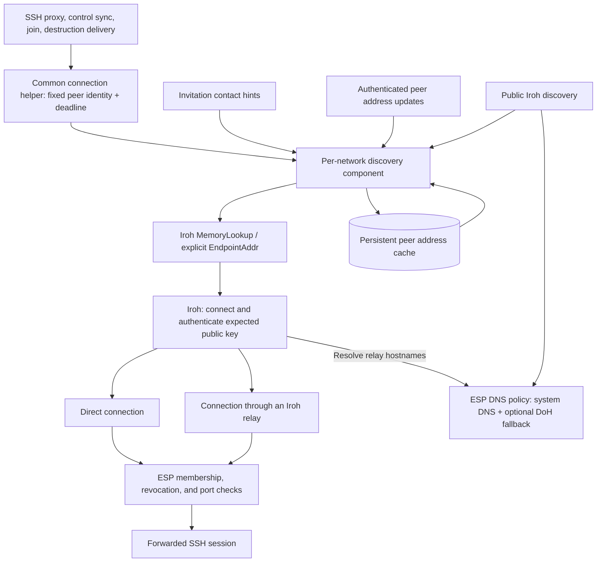
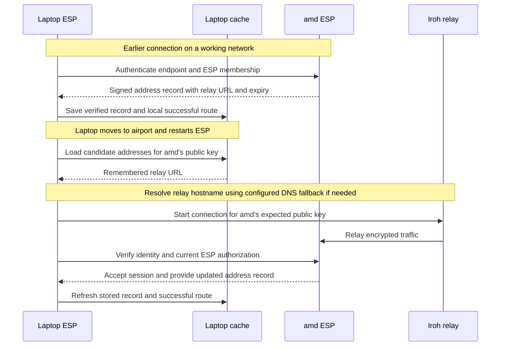
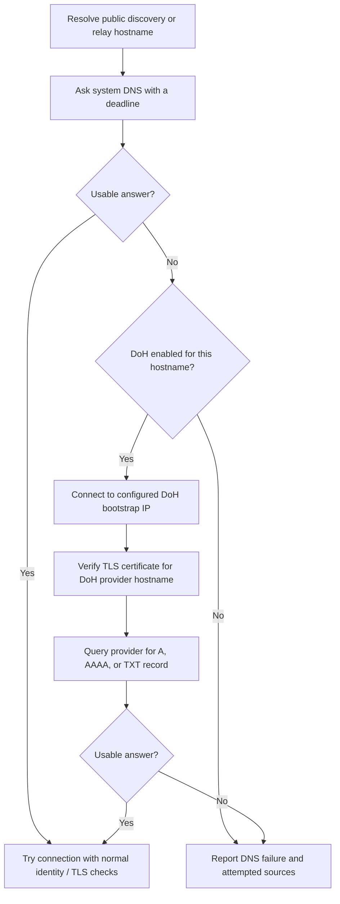

# ESP discovery resilience plan

Status: proposed design; no implementation changes are included in this document.

This plan explains how ESP can keep connecting when a public Wi-Fi network or DNS
provider blocks Iroh's discovery service. It assumes basic familiarity with
programming and computer networks; specialized terms are explained below.

## 1. Intended outcome

After a successful connection at home, a user should be able to restart ESP at an
airport and run the same `ssh amd` command even when public peer discovery is
unavailable, provided a remembered route to `amd` still works. A new installation
should also be able to join using an invitation that contains contact information.

Implement three complementary improvements:

1. Persist useful peer addresses across process restarts.
2. Exchange authenticated address updates and include contact information in
   invitations.
3. Support configurable DNS over HTTPS for discovery and relay hostnames when
   ordinary DNS fails or returns blocked addresses.

These changes use ESP's existing Rust and Iroh architecture. They do not require
Tailscale, a virtual network interface, a local DNS server, or a new central ESP
service. Existing public Iroh discovery remains available for finding fresh
addresses.

The limit is physical reachability: an address book cannot make an offline host,
a blocked relay, or an inaccessible network reachable.

## 2. Concepts and the connection to MagicDNS

| Term | Meaning in this design |
|---|---|
| Peer identity | The public key identifying a particular ESP endpoint. It remains stable while the machine keeps that network's secret key. |
| Connection address | A location where that endpoint may be reached, such as an IP address and port or an Iroh relay URL. It can change. |
| Discovery | Looking up connection addresses using a peer identity. |
| Relay | A server that carries traffic between peers when a direct connection is unavailable. Finding the relay and connecting through it are separate steps. |
| Cache | A local copy of previously learned information. Persistence means saving it to disk so it survives restarts. |
| Bootstrap | Obtaining enough initial contact information to make the first connection. |
| Authentication | Verifying who a peer is. Knowing an address does not establish identity or grant access. |
| Control protocol | Messages that exchange membership, policy, and other network information. These are separate from the user's forwarded SSH traffic. |
| DNS over HTTPS (DoH) | Sending DNS questions to a chosen resolver through an authenticated HTTPS connection. |

MagicDNS's resolver is open source under the BSD 3-Clause license. It answers
Tailscale peer-name queries from locally available network information. Tailscale's
coordination system supplies that information and separately helps devices find
connection paths. Public domain queries are forwarded upstream.
[MagicDNS source](https://github.com/tailscale/tailscale/blob/main/net/dns/resolver/tsdns.go),
[license](https://github.com/tailscale/tailscale/blob/main/LICENSE),
[Tailscale control plane](https://tailscale.com/docs/concepts/control-data-planes).

For ESP, `amd` already resolves locally to a public key. The missing information
is where to contact that key. The useful design principle to adopt is maintaining
and updating a local peer address book. Copying MagicDNS's DNS server would still
leave ESP needing a source for those addresses.

## 3. What failed, and what the current code does

The reported laptop resolved `dns.iroh.link` to `0.0.0.0` and `::`, and its TXT
query received `REFUSED`. Curl then attempted a local connection and failed before
contacting Iroh. This strongly indicates DNS filtering. The responding address,
`100.100.100.100`, belongs to Tailscale's local DNS forwarder; the evidence does
not identify whether the blocking originated in airport DNS, a configured
upstream provider, or another local component.

ESP's two discovery paths are different interfaces to the same infrastructure.
Even its HTTPS lookup first needs an IP address for `dns.iroh.link`, so filtering
that hostname can defeat both paths.



Repository inspection establishes these starting points:

| Existing code | Relevant behavior |
|---|---|
| [`src/main.rs`](src/main.rs): `Peer` | Stores the node ID, name, and connection ID; no persistent connection addresses. |
| [`src/networks.rs`](src/networks.rs): `Runtime::start` | Builds one Iroh endpoint per network using the N0 discovery preset and default relays. |
| [`src/main.rs`](src/main.rs): `open_proxy_tunnel`, `sync_known_peer_from_actor`, `sync_joined_config_once` | Connect using only the peer ID. The join path constructs its own temporary endpoint. |
| [`src/destruction.rs`](src/destruction.rs): `deliver` | Also connects by peer ID; address resilience must cover destruction notifications. |
| [`tests/proxy.rs`](tests/proxy.rs): `ProxyFixture` | Already uses explicit relay addresses with `MemoryLookup`, a private relay, and public discovery disabled. |

The inspected lockfile selects Iroh 1.0.3. Its `EndpointAddr` carries contact
information, and `MemoryLookup` supplies locally known addresses to an endpoint.
It is an in-memory component, so ESP must provide disk storage and update rules.
[Iroh MemoryLookup documentation](https://docs.rs/iroh/1.0.3/iroh/address_lookup/memory/struct.MemoryLookup.html).

## 4. Proposed architecture

Introduce a per-network discovery component, owned by the existing network
runtime. It manages candidate addresses, local storage, address exchange, and
connection diagnostics. A shared endpoint factory applies the same DNS policy to
both long-running endpoints and temporary endpoints used during joining.



The address cache answers **where to try**. Iroh and ESP continue to decide
**who answered and what they may do**. A cached IP that later belongs to another
machine must never cause ESP to accept that machine as `amd`.

## 5. Persistent address storage

### Storage and ownership

Use a versioned sidecar file at
`~/.esp/discovery/<network_uuid>.yml`. Keep identity and membership state in the
existing network file. Index entries by public key inside the network UUID;
names are display labels and must not identify cache entries.

The runtime owns one serialized writer so concurrent connections cannot overwrite
each other's updates. Reuse ESP's private-file protections: directories with mode
`0700`, files with mode `0600`, symlink checks, bounded reads, and atomic file
replacement. Batch routine cache writes. Durable signing counters require stricter
ordering, described below.

On startup, load valid records for currently authorized peers before accepting
proxy requests. Missing cache files are normal. Malformed or oversized cache data
produces a diagnostic and is excluded without preventing the network from
starting or altering its identity. Do not silently recreate damaged signing
counter state under the same key.

### Two kinds of stored information

Keep portable signed address records separate from local observations:

| Data | Purpose |
|---|---|
| Network UUID and peer public key | Bind addresses to one peer in one ESP network. |
| Relay URLs and optional direct socket addresses | Supply candidate connection paths. |
| Signed sequence number, issue time, and expiry | Order peer-authored updates and bound their useful lifetime. |
| Signature | Let a recipient verify who published the record, even when another peer forwards it. |
| Local last-success time and successful route | Prefer a path that this machine has actually used. |
| Local source, last failure, and retry time | Explain behavior and avoid repeatedly trying a broken address. |

Collect candidates from lookup results and Iroh's connection/path information.
Mark a route as locally successful only after endpoint authentication and ESP
authorization complete. Keep observed information distinct from peer-signed
records; a successful connection does not create a portable signature from the
remote peer.

Prefer relay URLs in portable records. Direct addresses often become invalid when
Wi-Fi, routers, or NAT mappings change. By default, keep directly observed socket
addresses local; allow sharing them within a network as an explicit option.
Do not expand Iroh's public address publication merely to implement this feature.

Suggested starting limits, to be adjusted from tests:

- At most two relay URLs and eight direct socket addresses per peer record.
- At most one current signed record per known peer; a record is at most 4 KiB.
- Signed records expire within 24 hours and refresh every 30 minutes while the
  daemon is serving, and promptly after an address change.
- Direct address observations expire after ten minutes. If direct addresses are
  shared, give them their own signed validity limit of at most ten minutes.
  Retain locally successful relay hints for up to seven days after success as
  lower-priority candidates.
- Bound total disk usage and background work using the network's peer limit and
  a process-wide budget.

Expiry means “do not advertise this as current.” A previously successful local
relay hint may still be tried during its retention period, with fresh identity
and membership checks. Never forward expired signed records as fresh updates,
extend their expiry on receipt, or treat the existence of a record as proof that
a peer is online.

## 6. Authenticated address exchange and invitations

### Address records

Define an ESP-owned `PeerAddressRecordV1`, encoded in deterministic CBOR. CBOR is
a compact binary message format already used by ESP. Deterministic encoding means
the same fields always produce the same bytes, which is necessary for reliable
signature verification.

Sign the record with the existing per-network endpoint key. Include the network
UUID, subject key, addresses, sequence number, issue time, expiry, and a fixed
purpose string such as `esp/address-record/1` in the signed bytes. The purpose
string prevents interpreting a signature intended for another message type as an
address-record signature.

Persist the next local sequence number before publishing its record. Receivers
persist the highest accepted number for each peer, reject older updates, and
require identical contents when a number repeats. Enforce bounded expiry and a
small clock-skew allowance. A restored backup with an old counter must be detected
and recovered explicitly; silently restarting the counter would defeat ordering.

Verify the signature and current membership before accepting an address record.
Process known revocations before address updates in the same exchange. A valid
address signature conveys no permission to forward a port or introduce a member.

### Exchange protocol

Add an independently versioned application protocol, `esp/address/cbor/1`, for
address exchange. Iroh uses an application protocol identifier, or ALPN, to select
which protocol a connection will speak. Keeping this separate lets existing
version 3 control and TCP protocols continue working.

Peers exchange their own records after membership authentication. An administrator
may also distribute signed records for peers already authorized in that network,
matching the current directory-advertising rule. Ordinary peers initially exchange
only their own records. Sending a record for another peer does not allow the
sender to modify it.

Use `Endpoint::watch_addr()` to notice changes to the local Iroh address. Debounce
rapid changes, create a new signed record, update local storage, and schedule
bounded exchanges. Refresh on successful connections and periodically while a
serving daemon is active. Exchange failure must not interrupt an established SSH
session or keep an otherwise idle outgoing helper alive indefinitely.

Paginate directory updates below the existing 65,535-byte remote frame limit.
Bound page counts, response size, concurrency, and retry rates. Remember an old
peer's lack of protocol support temporarily so it is not probed on every request.



This exchange cannot start until at least one route works. If every cached address
is stale, ESP still needs public discovery, a new invitation/contact hint, or a
reachable authorized administrator. It must not assume that peer exchange solves
its own initial-contact problem.

### Invitations

Introduce a version 4 invitation envelope containing the existing invitation
information plus a signed contact record for the inviter. Keep existing version 3
membership certificates and network identities. New clients read both invitation
versions; old clients reject the new invitation version clearly.

Generate contact information from the running endpoint when possible. If a usable
record is unavailable, retain the ability to issue an invitation and clearly
report that joining will require discovery. Do not fabricate a relay address.

The join path temporarily installs the inviter's hints before its first connection.
Check that the record's network and public key match the invitation, then perform
the existing creator, network-label, membership, and single-use-secret checks.
An expired hint must not prevent trying public discovery. Invitation secrets must
never enter address caches or diagnostics.

## 7. DNS fallback that covers the whole connection

DoH authenticates and encrypts communication with the chosen DNS resolver. It can
avoid modification by the local network, but the chosen resolver can still apply
its own filtering. Networks can also block the resolver's HTTPS connection.
[DoH protocol, RFC 8484](https://www.rfc-editor.org/rfc/rfc8484.html).

Implement an application-scoped DNS policy and supply it through Iroh's
`Endpoint::builder(...).dns_resolver(...)`. Iroh's locally available dependency sources
provide a custom `Resolver` interface. First verify with a small integration test
that the injected resolver covers DNS TXT discovery, PKARR HTTPS publication and
lookup, and relay hostname resolution in version 1.0.3. Explicitly configure any
lookup client that does not inherit it.

Support `system_only` and `system_then_doh`. Initially preserve `system_only` for
existing configurations and document `system_then_doh` as the resilient setting.
Make the provider and its bootstrap addresses configurable, with global defaults
and optional per-network overrides. A public provider such as Cloudflare is
one possible preset; adding a provider does not require changing the peer protocol.
[Cloudflare DoH documentation](https://developers.cloudflare.com/1.1.1.1/encryption/dns-over-https/).



Required behavior:

- Treat `REFUSED`, timeouts, and an address set containing only unusable values
  such as `0.0.0.0` or `::` as fallback triggers for approved public hostnames.
  Also allow a bounded second lookup after a connection fails using a suspect
  system answer. Do not replace a mixed answer containing usable addresses merely
  because one address is unusable.
- For approved infrastructure names, an unexpected negative answer can trigger a
  DoH check. A valid negative answer from both sources remains a failure.
- Cover both the discovery service and relay hostnames. Saving a relay URL does
  not remove the need to resolve that relay's hostname.
- Bootstrap DoH using configured IP addresses while retaining the provider
  hostname for TLS certificate validation and HTTP routing. Otherwise resolving
  the DoH provider could depend on the same broken DNS path. Never disable TLS
  verification or permanently hardcode Iroh's current server IP as the fix.
- Use HTTPS over TCP, without requiring HTTP/3 or working UDP. Keep provider
  bootstrap addresses replaceable and exercise IPv4 and IPv6 in tests.
- Apply fallback automatically only to approved public infrastructure names.
  Private domains and custom internal relays use system DNS unless explicitly
  configured otherwise. Disclose the chosen provider because it receives queries.
- Honor DNS TTLs and reset network-dependent failures when interfaces or DNS
  settings change. Bound retries by the caller's overall deadline, even if the
  network changes repeatedly.

The custom resolver must distinguish an authoritative “name does not exist”
answer, an empty record set, a blocked response, and a transport failure. If the
Iroh resolver interface hides information required for diagnostics, add the
necessary reporting in ESP's DNS adapter rather than inferring it from a generic
connection error.

## 8. Connection scheduling and recovery

Use one connection helper for proxying, control synchronization, joins, address
exchange, and destruction delivery. All candidate routes must target the same
expected public key and share one bounded connection deadline.

1. Load permitted cached or invitation addresses and try them immediately.
2. Refresh discovery when the cache is missing, old, or fails. Start refresh after
   a short bounded head start for cached addresses, rather than waiting through a
   full failed relay timeout. Successful cached connections refresh asynchronously
   when their records need renewal.
3. Combine fresh candidates, remove expired direct addresses, and retry only
   within the remaining setup budget. Avoid duplicate refreshes when several SSH
   sessions target the same peer.
4. After successful endpoint authentication and ESP authorization, record success
   and schedule address exchange. Cancel unused lookup and connection attempts.
   Address-exchange connections must not recursively schedule another exchange.
5. On failure, report which stage failed: discovery, DNS, relay connection, peer
   authentication, or ESP authorization.

Do not assume that registering `MemoryLookup` before other services makes Iroh
try it first. Likewise, a stale explicit relay may prevent the desired automatic
lookup behavior. Verify version 1.0.3 behavior in the first implementation phase;
explicitly schedule discovery and replacement candidates in ESP where necessary.
Prefer replacing a peer's current address set over indefinitely merging old
addresses. Keep any intentionally retained fallback separate and bounded.

Keep the existing 15-second proxy setup deadline, set by
`LOCAL_CONTROL_SETUP_TIMEOUT`. Reserve part of it for the final ESP request and
acknowledgement; DNS and dialing must not each start a new full timeout. Pass an
absolute deadline through the common helper. Retain or tighten the existing
30-second join and 15-second destruction-delivery budgets. Validate exact timing
with simulated clocks and controlled failures.

After revocation, stop normal connection attempts and remove that peer's usable
cache entries. On local network removal, delete its cache. Global destruction
needs a special lifecycle: retain only the addresses required to deliver signed
destruction notifications while normal traffic remains disabled, and delete them
when delivery completes or the configured retention limit expires. Address hints
never reactivate a destroyed network.

## 9. Address validation and diagnostics

A signature proves who supplied an address; it does not prove that contacting the
address is appropriate. Validate relay schemes, ports, lengths, and destinations.
Use HTTPS relays by default, reject URL credentials, and permit private or
loopback relay destinations only through explicit local/test configuration.
Validate resolved relay addresses too, so a public-looking hostname cannot
silently redirect the client to a forbidden local service. Avoid unrestricted
HTTP redirects. Treat direct LAN paths separately, using network-specific address
policy and validated local observations so ordinary LAN connectivity is preserved.

Expose discovery information in `esp status NETWORK --peers` and propose an
`esp diagnose NETWORK PEER` command. The diagnostic command should show the chosen
peer identity, cache age and source, system DNS results, enabled DoH results, and
the stage at which connection setup failed. It must not change network settings,
redeem invitations, or weaken authentication.

Example diagnostic wording:

```text
Peer: amd
System DNS: dns.iroh.link returned 0.0.0.0 and ::
Interpretation: these addresses cannot reach the public discovery service
Encrypted DNS fallback: disabled
Cached relay: available; last successful connection 3 hours ago
Result: connected using cached relay information
```

Report observed responses separately from inferred causes. Do not label every
`REFUSED` response “airport blocking,” and do not present cached peers as online.
Keep invitation secrets, private keys, and unnecessary peer address details out
of routine logs.

## 10. Implementation phases

| Phase | Work and likely files | Completion criterion |
|---|---|---|
| 1. Establish Iroh integration behavior | Extend fixtures in `tests/proxy.rs`; prototype a shared endpoint factory and resolver injection. | Prove explicit relay use, stale-relay recovery, DNS injection coverage, and bounded setup under Iroh 1.0.3. Record any required adapter work. |
| 2. Persistent cache and common dialing | Add `src/discovery.rs`; integrate with `src/networks.rs`, connection sites in `src/main.rs`, and `src/destruction.rs`. | An authenticated successful route survives a full process restart; a corrupt cache is nonfatal; stale cached routes do not suppress fresh discovery. |
| 3. Encrypted DNS fallback | Add `src/discovery_dns.rs`, validated settings, and shared endpoint construction. | Cold-start discovery and relay connection succeed with controlled system-DNS sinkholing and an available test DoH resolver. |
| 4. Address exchange and invitations | Add `src/address_exchange.rs`, the versioned record codec, address ALPN, and invitation envelope support. | Authorized peers exchange records; a fresh client joins with invitation hints while public discovery is disabled. |
| 5. Diagnostics and release | Extend `src/status_output.rs`, command dispatch, `README.md`, and integration tests. | Users can identify the failing stage; macOS and Linux network transitions are checked; compatibility behavior is documented. |

Each phase should leave a working application. Cache persistence and DNS fallback
can ship before every peer supports address exchange. Add dependencies only after
checking what Iroh already exposes; the main crate may need an explicit dependency
on `iroh-dns` to implement the resolver adapter.

### Compatibility and rollout

Keep existing network UUIDs, secret keys, memberships, and version 3 control/TCP
messages. The separate address protocol and cache schema have their own versions.
Older peers remain usable through existing discovery; they simply cannot provide
the new signed address records. For these peers, retain only locally verified
connection observations until they are upgraded.

New clients accept existing invitations. New address-bearing invitations require
new clients; provide a documented legacy-invitation option during rollout. Extend
the invitation parser explicitly rather than inserting fields into a strict old
schema and assuming compatibility.

New DNS configuration fields can make a configuration unreadable by an older
binary because ESP rejects unknown fields. Document removing those optional
settings before downgrading and preserve a configuration backup. Cache files are
separate and may be ignored by older binaries. No network recreation or identity
rotation is required for the normal upgrade.

## 11. Validation and acceptance criteria

Use deterministic local services in automated tests: a private relay, controlled
DNS responses, and a local HTTPS DNS server trusted only by the test. Extend the
existing relay fixture rather than depending on airport Wi-Fi or production DNS.

| Scenario | Required result |
|---|---|
| System DNS returns `0.0.0.0`, `::`, and TXT `REFUSED` | With fallback enabled, ESP obtains usable answers through DoH and connects. Without it, diagnostics identify the failed lookup. |
| Public discovery entirely unavailable; valid cached relay | A new process connects from disk state, with no hidden in-memory cache from the earlier run. |
| Cache empty; invitation contains valid contact hints | A fresh client joins when the indicated relay is reachable, even with public discovery disabled. |
| Cached relay stale; discovery advertises a new relay | Fresh lookup runs within the setup deadline and the successful route replaces stale state. |
| Relay hostname also blocked by system DNS | The same DNS fallback handles it; discovery success alone is insufficient. |
| DoH provider's hostname cannot use system DNS | Configured bootstrap addresses work with normal TLS validation. An invalid certificate fails. |
| UDP unavailable; relay reachable over TCP | SSH traffic crosses the Iroh relay successfully. |
| Cached address now reaches the wrong endpoint | Expected-key authentication fails; no session is accepted. |
| Forged, expired, replayed, cross-network, or revoked-peer records | Reject invalid updates and preserve applicable membership and revocation rules. |
| Concurrent updates and process interruption | Atomic storage remains parseable; signing sequence numbers are not silently reused. |
| Multiple networks contain a peer called `amd` | Addresses, DNS overrides, and authorization remain isolated by network UUID. |
| Wi-Fi or DNS settings change while ESP runs | Resolver state refreshes; callers retain bounded deadlines. |
| Old peer lacks the address protocol | Existing SSH behavior remains usable and background probes stay bounded. |
| Local removal or global destruction | Normal access stops; only required destruction deliveries retain temporary address hints. |
| Every route and resolver is unavailable | Fail within the deadline with actionable stage-specific diagnostics. |

For implementation changes, run targeted tests first, then `cargo fmt --check`,
`cargo check --tests`, `cargo test`, and `git diff --check`. Use isolated temporary
profiles. Finish with a manual macOS/Linux check covering restart, Wi-Fi change,
Tailscale DNS enabled and disabled, and an established SSH session during address
refresh.

The feature is complete when both previously known peers and freshly invited
clients pass the relevant discovery-failure scenarios without changing identity
or authorization guarantees. Successful DoH alone does not count: the tests must
establish the intended ESP connection and move application data through it.
