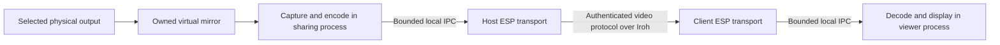

# ESP video sharing plan

Status: implementation started, October 23, 2026.

ESP will mirror one existing display into a virtual video output, encode its
frames, and deliver them to a view-only client over the existing authenticated
Iroh transport. ESP will own the display integration, session protocol, lifecycle,
and viewer implementation. Use independently selected libraries for codecs and
windowing; do not copy RustDesk code or introduce a RustDesk dependency.

## Scope and initial platform assumptions

The first release supports one selected source display, one mirrored virtual
output, and one viewer at a time per exporting ESP process. The source machine
may have several monitors, but only the explicitly selected monitor is shared.
The viewer displays the stream in a resizable window with optional fullscreen.

Keyboard and mouse forwarding, audio, clipboard, recording, USB forwarding,
multi-monitor streaming, extended desktops, and making the virtual output the
primary or only display are outside this release. Session negotiation, health
reports, and decoder recovery messages still travel from viewer to host; these
are protocol messages, not remote user input.

Planning defaults while platform and device preferences are unspecified:

- Start with a Linux host and Linux/macOS viewers. First validate a specific
  GNOME Wayland/Mutter version for hosting; broader Linux desktop support requires
  additional backend validation. macOS hosting and Windows are later backends.
- Interpret "virtual device" literally as an OS-visible virtual monitor that
  mirrors the selected output. An internal capture stream is a simpler alternative,
  but does not satisfy that literal requirement. The first implementation step
  must establish the actual virtual-monitor path before the feature is advertised.

This scope requires an existing, active graphical session and source display.
Headless startup and sharing a login screen are later work.

### Implementation progress

The optional `video` Cargo feature now exposes `esp video displays`. Its read-only
Mutter backend enumerates displays, records stable identities and current layout,
checks configuration/capture API availability, and computes a bounded stream
size from physical pixels. Tests use synthetic layouts and an isolated D-Bus
service. Existing display layout is not modified.

The current development environment has no active graphical session. Actual
virtual-mirror creation, capture, codec, and viewer validation remain in the first
milestone; the discovery report explicitly labels mirror support unvalidated.

## User workflow

These commands are proposed additions:

| Command | Behavior |
|---|---|
| `esp video displays` | List locally available source displays and whether the backend supports creating a mirror. |
| `esp video share NETWORK --display DISPLAY --peer PEER` | Create a mirror of that display and allow the selected network peer to view it. Run in the foreground. |
| `esp video view NETWORK HOST` | Open the host's currently shared display in a view-only window. |
| `esp video status [NETWORK]` | Report the share, selected source, viewer, stream format, connection state, and performance counters. |
| `esp video stop NETWORK` | Stop the local share and remove its virtual output. |

`share` may accept `--fps`, `--max-size`, and `--bitrate` within the implementation
limits below. Defaults target 30 FPS, a stream fitting within 1920 by 1080 pixels,
and 4 Mbit/s. These are encoder limits, not changes to the physical display mode.

The display must be chosen explicitly. Resolve its ID to a concrete backend
identity before creating the virtual output. Detect stale IDs and require a new
selection instead of falling back to another monitor. Resolve peer names once to
the network UUID and full peer public key, following existing ambiguity rules.

Show `preparing`, `ready`, `streaming`, and terminal errors clearly. Print `ready`
only after mirror creation and capture are verified. Ctrl-C or loss of the sharing
process ends the share. Closing the viewer releases its session while the host's
foreground share remains ready for another connection from the same allowed peer.

## Establish the virtual mirror backend first

Creating an OS-visible monitor and capturing an existing monitor are distinct
operations. The standard Linux ScreenCast portal describes `MONITOR` as capture
of an existing monitor and `VIRTUAL` as extension with a new virtual monitor. It
does not provide a general operation to configure that new monitor as a clone.
[ScreenCast portal](https://flatpak.github.io/xdg-desktop-portal/docs/doc-org.freedesktop.portal.ScreenCast.html).

The initial feasibility experiment should target GNOME Wayland:

1. Enumerate the existing output and record its mode, scale, transform, layout,
   and primary-display state.
2. Investigate Mutter's `RecordVirtual` operation for creating an owned virtual
   monitor with a mode compatible with the selected output. Obtain its PipeWire
   stream and identify the new monitor without relying on a display index.
3. Validate a clone configuration through `DisplayConfig`, then apply it
   temporarily while preserving all existing outputs and the current primary.
4. Confirm that the virtual monitor is visible to the OS, really mirrors only
   the chosen source, and supplies matching captured pixels.
5. Exercise normal shutdown, process death, source removal, and display-layout
   changes before accepting this backend.

These are candidate integration points, not evidence that every Mutter version
supports the combination. Mutter explicitly marks its ScreenCast interface as
private and offers no version compatibility promise. Pin and test supported
versions, check capabilities at runtime, and isolate this code behind the display
backend. `DisplayConfig` exposes configuration serials and verification/temporary
application modes; use those to detect concurrent layout changes.
[Mutter ScreenCast interface](https://github.com/GNOME/mutter/blob/main/data/dbus-interfaces/org.gnome.Mutter.ScreenCast.xml),
[Mutter DisplayConfig interface](https://github.com/GNOME/mutter/blob/main/data/dbus-interfaces/org.gnome.Mutter.DisplayConfig.xml).

Do not silently substitute an extended monitor or ordinary capture if mirroring
is unavailable. Return `MirrorUnsupported`. If the experiment cannot meet the
requirement, revise the host backend or explicitly change the virtual-device
requirement before proceeding with that platform. KDE, wlroots, and X11 need
their own verified approach; loading VKMS alone is not a complete mirror solution.

If an internal mirrored output is selected instead, use the ScreenCast portal
with `MONITOR`, `multiple=false`, and exactly one returned stream. Keep the portal
session alive and consume its authorized PipeWire connection. That alternative
does not modify the host display layout and leaves the remaining media and
transport design unchanged.

### Display ownership and cleanup

- A `MirrorLease` owns the created output and capture session. Only the owning
  sharing process may change or release it.
- Keep the virtual output's mode compatible with the source; resize frames for
  transmission downstream. Never lower the physical display resolution to match
  the network stream.
- Apply only temporary layout changes. On shutdown, remove the owned virtual
  output and reconcile the surviving layout. Restore a saved configuration only
  if it still matches the expected topology and configuration generation; do not
  overwrite display changes made by the user in the meantime.
- Require automatic removal on owner/session death as a backend acceptance
  criterion. If a backend needs a cleanup helper, prove that helper's failure
  behavior before supporting it.
- Source disconnection, capture permission loss, logout, or loss of a verified
  mirror terminates the share. Never switch to another source automatically.
- On source mode/scale/rotation changes, stop media, revalidate the mirror, and
  begin a new stream generation. End the share if revalidation fails.
- Stop sharing when the source session locks. Require a new local `share` to
  resume. The initial backend must provide a tested lock/session-loss signal.

## Architecture and process boundaries



Keep capture and GUI work in the user's graphical session. The shared transport
continues to own network keys and Iroh endpoints. It authenticates sessions and
forwards encoded frames; it does not create windows or load media codecs.

The foreground sharing process owns the display and encoder. Its long-lived
local connection registers an ephemeral share with the manager. The viewer
process owns its window and decoder, with its GUI event loop on the main thread.
Codec work runs on bounded worker threads, separate from Tokio transport tasks.

Define narrow interfaces for `DisplayBackend`, `MirrorLease`, `FrameSource`,
`VideoEncoder`, and `VideoDecoder`. Backends report capabilities and typed errors.
Raw frame metadata includes dimensions, stride, pixel format, orientation,
color description, and a capture timestamp. Release capture buffers promptly;
never hold a PipeWire buffer while awaiting network writes.

## Integration with the current ESP code

| Existing component | Planned change |
|---|---|
| [`src/main.rs`](src/main.rs): CLI and local request enums | Add video commands and typed local requests using new CBOR variant numbers. |
| [`src/main.rs`](src/main.rs): incoming ALPN dispatch | Route a separate video protocol through existing connection quotas and cancellation guards. |
| [`src/main.rs`](src/main.rs): configuration actor and membership verification | Add service-specific authentication using existing certificate, policy, network, and revocation checks. Keep TCP port authorization specific to TCP. |
| [`src/networks.rs`](src/networks.rs): `Runtime`, `Manager`, local streaming dispatch | Register video ALPN, manage share leases, and bridge typed video IPC outside the manager lock. |
| [`src/transport.rs`](src/transport.rs) | Reuse shared-helper startup for sharing and viewing; add video session setup. |
| [`src/discovery.rs`](src/discovery.rs) | Reuse the common endpoint construction path and any subsequently completed discovery work. |
| [`tests/proxy.rs`](tests/proxy.rs) | Reuse the private-relay fixture pattern for independent video tests. |

There are ongoing discovery and proxy changes in this checkout. Implement against
their final interfaces rather than introducing a second discovery or endpoint
factory. Preserve the existing TCP authorization behavior with regression tests
when extracting shared identity-validation code.

Registering a foreground share enables only that video share. It must not promote
an outgoing helper into unrestricted TCP serving. Long-lived sharing/viewing IPC
connections keep the existing idle-managed helper alive. Network destruction,
revocation, or manager shutdown cancels sessions and notifies the local owner to
release the virtual display.

## Authentication and sharing permissions

Sharing is disabled until a local user starts `share`. The in-memory grant binds
the share UUID, network UUID, selected output, owner IPC connection, and exactly
one allowed peer public key. Do not persist an unattended sharing grant in v1.

The viewer and host exchange bounded membership proofs on the video connection.
Validate the certificate subject against the authenticated Iroh remote ID, the
network creator and chain, current policy, completed membership, and revocations.
The viewer also verifies that the server is the selected host in that network.
An Iroh public key or a matching hostname alone is not sufficient authorization.

The host requires both valid network membership and its explicit local viewing
grant. Administrator role and existing SSH port access do not imply permission
to see the screen. Video neither reuses port 22 as a permission nor invents a
magic TCP port to represent the service.

Process revocations inside the actor before admitting a session. Register
cancellation guards on both ends and recheck the live grant before sending
`Ready`. Revoking the peer, stopping the share, destroying the network, or losing
the owner connection must stop video promptly and prevent further attachment.
Retain the existing limitation that an offline node learns remote revocations
when the signed update reaches it.

## Capture format and codec

Use VP8 through the upstream libvpx library as the initial portable codec. Own
the wrapper, frame handling, transport, and session logic. Select and pin a
maintained binding after a build experiment, or provide a small audited FFI
boundary. Pin the native library as well and retain its license and patent-grant
notices. libvpx provides VP8 encoding/decoding and uses a BSD-style license.
[libvpx](https://github.com/webmproject/libvpx),
[license](https://github.com/webmproject/libvpx/blob/main/LICENSE).

Start with software encoding and decoding, with zero lookahead, low-delay
settings, no alternate-reference-frame buffering, and bounded codec threads.
Force an independently decodable keyframe at attachment and each generation
change; configure periodic keyframes at least once per second during motion.
Validate actual encoder output rather than assuming every encode call emits
exactly one displayed frame. [Encoder API](https://github.com/webmproject/libvpx/blob/main/vpx/vpx_encoder.h).

Initial limits are design targets to validate on reference hardware:

| Parameter | Initial value or bound |
|---|---|
| Source dimensions | At most 4096 pixels per axis and 16 megapixels total; reject larger sources in v1. |
| Encoded image | Fits within 1920 by 1080, preserves aspect ratio, uses even dimensions, and never upscales. |
| Frame rate | Default 30 FPS; configurable from 1 to 30. |
| Target bitrate | Default 4 Mbit/s; configurable from 0.5 to 12 Mbit/s. This is an average target, not a per-frame size guarantee. |
| Color | SDR, 8-bit YUV 4:2:0 with explicitly signaled matrix/range. |
| Encoded frame limit | 2 MiB; reject larger units before allocating or forwarding them. |
| Raw capture queue | One frame being processed and one replaceable pending frame. |

Honor row stride and crop, convert orientation once, and test RGB/YUV conversion
with known color patterns. Include the source cursor exactly once: request
embedded capture when supported, otherwise compose supplied cursor metadata on
the host. Unsupported cursor composition should produce an explicit limitation.
Require an SDR capture path; reject unsupported HDR/color formats rather than
silently applying an incorrect conversion. Lossy chroma subsampling may soften
small colored text; lossless desktop modes and hardware codecs are later work.

## Network protocol

Introduce `esp/video/cbor/1` as an independent ALPN. Keep current network identity,
membership, invitation, and TCP protocol versions intact. Use one Iroh connection
per viewing session, with one bidirectional control stream and a host-to-viewer
unidirectional media stream. Iroh 1.0.3 already exposes these stream operations
and cancellation facilities. [Pinned Iroh API](https://docs.rs/iroh/1.0.3/iroh/endpoint/struct.Connection.html).

Control messages use bounded CBOR with the existing 65,535-byte control-frame
limit. Define stable numeric tags and typed errors for these messages:

- `ClientHello`: protocol capabilities, network/membership proof, requested
  viewing limits, and a resume share UUID when reconnecting.
- `ServerHello`: server membership proof, active share UUID, source description,
  and capabilities, released only after client authorization.
- `Start` and `Ready`: mutually accepted codec, dimensions, color description,
  frame rate, bitrate ceiling, and initial generation.
- `ReceiverReport`, `RequestKeyframe`, `Ping`, `Pong`, `Stop`, and `Error`.

Do not define any keyboard, pointer, clipboard, audio, or host display-control
messages. Viewer-requested limits only affect the encoded stream, never the
host's physical display configuration.

Each media stream begins with a versioned header containing the share UUID,
generation number, and full decoder configuration. A generation identifies an
independent decoding timeline. Each frame carries a bounded binary header with
sequence number, capture timestamp relative to session start, keyframe flag, and
payload length, followed by encoded bytes. Use a four-byte length for media;
video frames must not pass through ESP's two-byte CBOR setup framing.

Validate lengths, integer arithmetic, dimensions, sequence progression, and
bitstream keyframe dimensions before handing data to the decoder. The first
frame of every generation must be a keyframe matching the negotiated format.
Reject media before authorization, client-originated media, unexpected stream
counts, and unsupported protocol versions.

## Backpressure and recovery

A reliable stream is the initial transport. Avoid a new unreliable packetization
and retransmission system in v1. Reliability still needs bounds on queued data,
including transport and IPC buffers, to prevent an increasingly delayed picture.

- Drop obsolete raw frames before encoding; the encoder then references only
  frames actually admitted to the media timeline.
- Limit encoded queues to two frames and 4 MiB in aggregate at each process
  boundary. Keep one decode operation and one pending presentation buffer.
- Decode dependent frames in sequence; obsolete decoded images can be skipped
  for presentation. Do not arbitrarily discard encoded interframes and then
  continue decoding their dependents.
- Use media write deadlines and receiver reports, initially every 250 ms while
  streaming. Reports echo the last presented sequence/timestamp. Measure backlog
  in the sender's time domain without subtracting unsynchronized host clocks.
  An unchanged desktop must not be mistaken for a stalled receiver.
- If queued frame age exceeds 500 ms, a write cannot progress, or the decoder
  reports lost state, abandon the current media stream, clear downstream queues,
  increment the generation, and start a fresh stream with a forced keyframe.
  Coordinate the switch on the control stream and reject late frames from old
  generations. Bound overlap to one retiring and one active media stream. Allow
  up to five seconds for the first keyframe of a generation before applying the
  steady-state lag threshold; a keyframe burst must not create an immediate
  reset loop. End the session if that bootstrap deadline expires.
- A full encoded IPC queue must propagate a generation reset to the owner;
  never silently lose an encoded frame inside a local bridge. Apply the same
  bounds and reset rules on both local IPC hops.
- Reduce bitrate and then frame rate within negotiated limits after sustained
  congestion. Limit resets to one per second and report `NetworkTooSlow` after
  repeated failure at the minimum supported rate instead of looping indefinitely.

Tune Iroh stream/connection windows so they do not hide an unbounded backlog.
Choose changes supported by the pinned Iroh version and measure their effect on
simultaneous SSH traffic before applying endpoint-wide settings. Shared relays and
links can still limit bandwidth; this design does not promise hard real-time video.

Use a 15-second authenticated setup deadline, five-second heartbeat interval,
and 15-second liveness timeout. Display creation and local user selection happen
before advertising the share, outside that remote setup deadline. Video liveness
must not depend on the TCP proxy's idle timeout in each direction.

On transient transport failure, the viewer clears the picture or marks it
disconnected and retries with bounded backoff for up to 30 seconds. Reauthenticate
each attempt and resume only the same share UUID. A new host share requires an
explicit new `view`; revocation and local stop never trigger automatic restart.

## Local IPC and helper lifetime

Add capability/version discovery before sending new streaming requests to a
running helper. If an older helper cannot serve video, report that it needs a
restart; do not kill it and interrupt active proxies. Peers without the video
ALPN return `UnsupportedVideo` while other ESP services remain usable.

Use new UUID-addressed local manager requests for share registration, viewing,
status, and stop. Each streaming local client holds a control/lease connection
and a separate media connection for the current generation. Associate the media
connection using a bounded, single-use attachment token issued on the private
control connection and tied to that session. It is not a remote viewing grant.

After setup, use dedicated, versioned local video framing with the same 2 MiB
per-frame limit as the wire protocol. Resetting a generation closes and replaces
its media connection, so partially written frames cannot corrupt the next
generation or block stop/reset messages. Keep control traffic small and bounded.
Share lifecycle changes remain serialized by the manager; media I/O never holds
the manager or configuration actor lock.

Reserve a preparing share before starting a media worker, but activate its
viewing grant only after verified mirror/capture readiness. EOF from the owner's
control connection removes the grant and cancels the remote viewer. EOF from the
viewer's control connection cancels the outgoing video connection. A media EOF
is recoverable only as part of an agreed generation reset; other media failures
end that session. Manager/network shutdown closes these IPC connections; the
sharing process responds by releasing its mirror. Unexpected shutdown cannot
leave an advertised grant without a live owner.

Because grants and display selections are ephemeral, v1 needs no new persistent
network configuration or signed certificate fields. New binary builds may add
local protocol variants and an optional video capability without recreating
existing networks.

## Viewer and dependency boundaries

Implement a small native viewer using `winit` and a `softbuffer` presentation
backend initially. Decode VP8, convert to the window's pixel format, preserve
aspect ratio with letterboxing, and support fullscreen and local close commands.
The viewer's keys and pointer never become network input events. Softbuffer
supports presenting CPU-rendered images through a cross-platform windowing layer.
[Softbuffer](https://github.com/rust-windowing/softbuffer).

Keep the last valid frame only while the session is healthy. Clear it on stop,
permission loss, or disconnect, and visibly distinguish waiting for a keyframe
from a live stream. Report negotiated resolution/FPS, bitrate, dropped raw frames,
and connection state without placing implementation details in the video image.

Separate optional Cargo features for video protocol support, Linux hosting, and
the viewer. Headless SSH-only builds must remain possible without desktop or
codec dependencies. Document native library installation and package the macOS
viewer with a stable application identity and its native codec dependencies.
Pin exact dependency versions during implementation and record license notices
for the selected build; independently implemented ESP code does not require
reimplementing established codec algorithms.

## Proposed module layout

```text
src/video/
  mod.rs          commands, shared types, limits
  protocol.rs     control messages and bounded media framing
  service.rs      share grants, session state, authorization
  transport.rs    Iroh sessions, generations, flow control
  ipc.rs          local owner/viewer streaming
  capture/mod.rs  display and frame-source interfaces
  capture/mutter.rs  initial virtual-mirror feasibility/backend
  codec.rs        owned libvpx encode/decode wrapper
  viewer.rs       window lifecycle and presentation
tests/video/      protocol, lifecycle, relay, and media tests
```

Keep source-display creation independent from stream codecs and viewer rendering.
A later primary-output mode should be a new backend capability and explicit
local command, rather than a mode that can be selected remotely in v1.

## Implementation sequence

1. **Prove display and codec feasibility.** Establish the platform/device
   scope. On real hardware, create one OS-visible mirror, acquire frames,
   remove it safely, and validate lock/hotplug behavior. Separately build a libvpx
   encode/decode loop and the minimal window on Linux and macOS. Record supported
   versions and dependency choices. A capture-only demo does not close this step
   if an OS-visible mirror remains required.
2. **Add the service and wire protocol with synthetic frames.** Implement
   ephemeral grants, mutual membership validation, bounds, generation resets,
   local capability negotiation, and helper lifetime. Exercise direct and forced
   relay paths before integrating desktop capture.
3. **Connect the real mirror and encoder.** Implement owned capture buffers,
   scaling/color/cursor handling, bounded worker queues, and encoder recovery.
   Expose share/status/stop commands and all terminal cleanup paths.
4. **Complete the viewer and recovery behavior.** Integrate decoding and local
   presentation, fullscreen, disconnect state, generation changes, liveness, and
   reconnect to the same share. Validate Linux-to-Mac explicitly.
5. **Validate performance and package the feature.** Run the acceptance matrix,
   tune bounds using measured results, document backend limitations and required
   packages, and publish only the OS/backend combinations that passed.

## Validation and acceptance

Automated tests should cover behavior and failure boundaries:

- Certificate/identity mismatch, wrong network, revoked membership, missing
  viewing grant, expired owner lease, and simultaneous second viewer rejection.
- Stop and revocation while connecting, streaming, blocked on a write, or
  resetting a generation; network destruction and helper shutdown as well.
- Fragmented/truncated messages, oversized frame declarations, invalid codec
  headers, unsupported formats, integer overflow, stream floods, stale generations,
  and first-frame/keyframe violations. Fuzz the framing parser.
- Known-pattern encode/decode, stride/crop/rotation/color correctness, cursor
  composition, and resizing. Assert image properties with lossy-codec tolerances,
  not exact encoded bytes.
- Static desktops, slow readers, congested IPC, encoder failure, damaged media,
  reconnect, and repeated generation resets. Assert bounded queues and absence
  of tasks left running after cancellation.
- Real Iroh direct and private forced-relay sessions, using synthetic capture so
  CI does not need a graphical desktop. Keep one SSH session exchanging data
  during streaming and verify that video cancellation does not close it.
- Compatibility with peers/helpers lacking video support and builds with video
  features disabled.

Hardware validation must prove the actual user-visible requirement:

| Scenario | Acceptance condition |
|---|---|
| Several host monitors | Exactly the selected output is mirrored and streamed; no combined-desktop capture. |
| OS-visible virtual display | It appears in display configuration as a clone of the source; source mode and primary designation are preserved. |
| Normal and abnormal exit | The owned virtual output disappears; existing displays remain usable and no sharing grant survives. |
| Source unplug, layout change, lock, logout | Safe stop or verified generation change; no automatic retargeting or exposure of a different display. |
| Linux viewer and Apple Silicon Mac viewer | Both display the same live source with correct orientation, aspect ratio, and color. |
| 1080p30 reference workload | Measure and record CPU, memory, actual FPS, average/peak bitrate, and readable desktop text. |
| Low-latency LAN | Target median source-to-view latency below 150 ms and p95 below 300 ms on named reference hardware. |
| 100 ms RTT, 1 percent loss, 8 Mbit/s shaped link | Bounded memory and queues; recovery rather than persistent corruption or accumulating old frames. |
| Connectivity restored | Target a new decodable picture within three seconds when the same share remains available. |

The performance numbers are validation targets, not measured guarantees. Measure
source-to-view latency using synchronized test instrumentation or an external
camera; timestamps from unrelated machine clocks alone are insufficient. Include
a 30-minute streaming soak and repeated start/stop cycles. Exercise a real relayed
path separately from a controlled local relay.

During implementation run formatting, compilation, and existing regression tests
alongside the new video feature combinations. Test display changes only in an
explicit interactive hardware session; normal automated tests use fake backends
and temporary ESP profiles.
