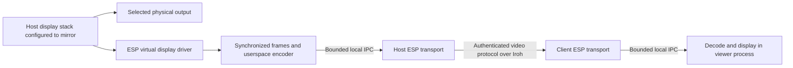

# ESP video sharing plan

Status: experimental driver, video service, codec, and viewer implemented, October 23, 2026.
Live display-stack compatibility and performance validation are pending.

ESP will mirror one existing display into a virtual video output, encode its
frames, and deliver them to a view-only client over the existing authenticated
Iroh transport. ESP will own the display integration, session protocol, lifecycle,
and viewer implementation. Use independently selected libraries for codecs and
windowing; do not copy RustDesk code or introduce a RustDesk dependency.

## Scope and initial platform assumptions

The first release supports one selected source display, one mirrored virtual
output, and one viewer at a time per exporting ESP process. The source machine
may have several monitors, but only the explicitly selected monitor is shared.
The viewer displays the stream in a resizable window with optional fullscreen.

Keyboard and mouse forwarding, audio, clipboard, recording, USB forwarding,
multi-monitor streaming, extended desktops, and making the virtual output the
primary or only display are outside this release. Session negotiation, health
reports, and decoder recovery messages still travel from viewer to host; these
are protocol messages, not remote user input.

The selected architecture is an OS-visible virtual display driver. The host
renders into that output as it would into a connected monitor; ESP consumes its
frames, encodes them, and sends them over the network. Capture and streaming must
not require GNOME, Mutter, KDE, wlroots, or desktop-specific discovery APIs.

- Linux hosting is the initial planning target, with Linux/macOS viewers; this
  platform scope remains provisional. Other host OSes need their own display
  device integration while sharing the media and network implementation.
- Investigate existing Linux DRM/KMS virtual-display support before deciding
  whether ESP needs its own kernel module. A driver-based architecture is selected;
  the specific driver and userspace interface are not yet selected.
- The virtual output must mirror exactly one existing output. Creating a new
  output alone does not establish mirroring. Initial setup may use the host's
  normal display settings; automatic desktop-specific layout configuration is
  outside this design.

This scope requires an existing, active graphical session and source display.
Headless startup and sharing a login screen are later work.

### Implementation progress

- Added an ESP DRM/KMS virtual-display module and exclusive `/dev/esp-video`
  frame interface. Closing the owning file disconnects the output. Compilation
  passes against installed 6.18.55 and 7.2.9 kernel headers. Isolated VMs running
  both kernels pass actual frame capture, repeated scanout, owner-death cleanup,
  and module-unload tests. Real graphical-desktop mirroring remains untested.
- Replaced Mutter discovery with read-only DRM enumeration and source identities
  derived from device, connector, and EDID. No desktop-specific capture API remains.
- Implemented foreground `share`, `view`, `status`, and `stop`, ephemeral peer
  grants, mutual membership validation, revocation cancellation, bounded media
  framing, presentation feedback, and direct/relayed Iroh video sessions.
- Added a libvpx software VP8 wrapper with BT.601 limited-range conversion and a
  winit/softbuffer viewer with resizing and F11 fullscreen. These are optional
  Cargo features; the default build remains SSH-only.
- The experimental host uses manual mirror setup and explicit local source
  confirmation. It checks source and virtual-output activity/modes and logind
  session/lock state. This is not automatic cross-GPU clone verification; later
  layout changes cannot be fully detected through this interface.
- Congestion ends the current connection/timeline, lowers bitrate and then frame
  rate, and lets the viewer reconnect to the same share with a new decoder and
  keyframe. Same-connection generation reset is deferred.

Synthetic tests cover real direct and private forced-relay transport, grants,
revocation, stop, stale shares, single-viewer limits, malformed media, presentation
stalls, framing bounds, sizing, congestion policy, and codec color round trips.
No test loads a module or alters the host display layout. Actual capture, cursor,
lock reporting, display adoption, Linux-to-Mac presentation, and performance still
require an interactive validation session. See
[build and driver setup](drivers/esp_video/README.md).

## User workflow

These commands are proposed additions:

| Command | Behavior |
|---|---|
| `esp video displays` | List driver-visible outputs, virtual-device capabilities, and mirror verification support. |
| `esp video share NETWORK --display DISPLAY --peer PEER` | Create the virtual output, wait for local mirror confirmation and a driver frame, and allow the selected peer to view it. Run in the foreground. |
| `esp video view NETWORK HOST` | Open the host's currently shared display in a view-only window. |
| `esp video status NETWORK` | Report the share, selected source, viewer, stream format, connection state, and performance counters. |
| `esp video stop NETWORK` | Stop the local share and remove its virtual output. |

`share` accepts `--fps`, `--max-size`, and `--bitrate` within the implementation
limits below. Defaults target 30 FPS, a stream fitting within 1920 by 1080 pixels,
and 4 Mbit/s (`--bitrate 4000`, in kbit/s). These are encoder limits, not changes to the physical display mode.

The display must be chosen explicitly. Resolve its ID to a concrete backend
identity before creating the virtual output. Detect stale IDs and require a new
selection instead of falling back to another monitor. Resolve peer names once to
the network UUID and full peer public key, following existing ambiguity rules.

Show setup, waiting, readiness, and terminal errors clearly. Instruct the local
user to select mirroring in normal display settings and type the selected source
connector name to confirm. Print `ready` only after that local confirmation,
virtual-output activation, and receipt of a driver frame. Automatic proof of the
clone relationship remains a separate capability. Ctrl-C or loss of the sharing
process ends the share. Closing the viewer releases its session while the host's
foreground share remains ready for another connection from the same allowed peer.

## Establish the virtual display driver first

Expose a display device through Linux DRM/KMS, with monitor identity, supported
modes, hotplug/lifetime behavior, and an explicit frame-delivery interface to the
ESP sharing process. The driver receives rendered output; encoding, networking,
and peer authorization stay in userspace. ESP must not read arbitrary physical-GPU
memory or assume that a framebuffer represents the final composed image.

VKMS is a software KMS driver worth investigating. DRM writeback provides a
mechanism for writing display output into memory. Neither establishes that a
virtual device will be adopted by an existing desktop, mirror a physical GPU's
output, or provide unattended frame access. These are feasibility gates rather
than assumed capabilities.
[VKMS documentation](https://kernel.org/doc/html/latest/gpu/vkms.html),
[DRM/KMS documentation](https://docs.kernel.org/gpu/drm-kms.html).

The driver implementation and hardware validation must:

1. Evaluate an existing virtual driver and identify any missing functionality
   requiring a custom module. Record supported kernels, installation/loading
   requirements, device permissions, and module-signing requirements where relevant.
2. Expose one virtual monitor alongside the physical GPU without replacing the
   active display server or taking its DRM master ownership. Verify that the host
   detects and can drive the output through its normal display configuration.
3. Configure a mirror through normal display settings and preserve the source's
   mode, primary designation, and all other monitors. Prove how ESP identifies
   and verifies the selected source and clone relationship without compositor
   APIs. Cross-device mirroring may not be observable through DRM alone; resolving
   this is a blocking design question, not permission to infer mirroring from size.
4. Acquire complete virtual-output frames through a documented driver/userspace
   interface. Specify buffer allocation, formats, stride, synchronization fences,
   cursor/overlay composition, timestamps, and release semantics. Validate that
   this works while the compositor owns display configuration.
5. Exercise shutdown, owner death, source removal, mode changes, lock, and logout.
   Test multiple desktop environments using the same ESP backend and record the
   kernel/GPU/display-stack combinations that actually pass.

Creating a monitor does not make it mirror another monitor: the host's display
stack chooses what to render to it, just as with HDMI. The experimental implementation requires manual mirror setup and a local source
confirmation before network frames are released. It verifies output activity and
matching dimensions, which alone do not prove a clone relationship. Do not claim
automatic mirroring or silently substitute ordinary screen capture. A future
automatic mode must report `MirrorUnsupported` if the relationship cannot be
verified.

The implementation must not require Mutter discovery, ScreenCast portal sessions,
or PipeWire as its frame source. A userspace driver helper may manage local device
access, but it must have a narrow interface and only the privileges needed for the
owned virtual output. Never run the network transport or media decoder as root.

### Display ownership and cleanup

- A `MirrorLease` owns the created driver output and frame-delivery session. Only the owning
  sharing process may change or release it.
- Keep the virtual output's mode compatible with the source; resize frames for
  transmission downstream. Never lower the physical display resolution to match
  the network stream.
- Keep the created output temporary. On shutdown, disconnect/remove that output
  and let the host display stack reconcile the surviving layout. Do not overwrite
  display changes made by the user or reapply saved desktop layouts.
- Require automatic removal on owner/session death as a backend acceptance
  criterion. If a backend needs a cleanup helper, prove that helper's failure
  behavior before supporting it.
- Source disconnection, driver access loss, logout, or virtual-output
  deactivation terminates the share. Never switch to another source automatically.
- On detectable source mode changes, stop the experimental share and require a
  new local confirmation. Scale, rotation, and clone-layout changes that preserve
  physical modes are not reliably observable through DRM enumeration; a stronger
  backend must resolve this before claiming automatic revalidation.
- Stop sharing when the source session locks. Require a new local `share` to
  resume. Validate an OS/session-level lock and logout signal independently of frame
  capture. A driver alone cannot identify a locked desktop. If a reliable signal
  is unavailable on a target, that target does not satisfy this release policy;
  do not silently treat unchanged frames as a lock signal.

## Architecture and process boundaries



Keep device/frame access in the local sharing process and GUI work in the viewer's
graphical session. The shared transport
continues to own network keys and Iroh endpoints. It authenticates sessions and
forwards encoded frames; it does not create windows or load media codecs.

The foreground sharing process owns the display and encoder. Its long-lived
local connection registers an ephemeral share with the manager. The viewer
process owns its window and decoder, with its GUI event loop on the main thread.
Codec work runs on bounded worker threads, separate from Tokio transport tasks.

Define narrow interfaces for `DisplayBackend`, `MirrorLease`, `FrameSource`,
`VideoEncoder`, and `VideoDecoder`. Backends report capabilities and typed errors.
Raw frame metadata includes dimensions, stride, pixel format, orientation,
color description, and a capture timestamp. Release capture buffers promptly;
never hold a driver-owned buffer while awaiting network writes. A slow encoder
or network must not stall physical display presentation. Use bounded copies or
explicit buffer ownership transfers and honor producer completion fences.

## Integration with the current ESP code

| Existing component | Planned change |
|---|---|
| [`src/main.rs`](src/main.rs): CLI and local request enums | Add video commands and typed local requests using new CBOR variant numbers. |
| [`src/main.rs`](src/main.rs): incoming ALPN dispatch | Route a separate video protocol through existing connection quotas and cancellation guards. |
| [`src/main.rs`](src/main.rs): configuration actor and membership verification | Add service-specific authentication using existing certificate, policy, network, and revocation checks. Keep TCP port authorization specific to TCP. |
| [`src/networks.rs`](src/networks.rs): `Runtime`, `Manager`, local streaming dispatch | Register video ALPN, manage share leases, and bridge typed video IPC outside the manager lock. |
| [`src/transport.rs`](src/transport.rs) | Reuse shared-helper startup for sharing and viewing; add video session setup. |
| [`src/discovery.rs`](src/discovery.rs) | Reuse the common endpoint construction path and any subsequently completed discovery work. |
| [`tests/proxy.rs`](tests/proxy.rs) | Reuse the private-relay fixture pattern for independent video tests. |

There are ongoing discovery and proxy changes in this checkout. Implement against
their final interfaces rather than introducing a second discovery or endpoint
factory. Preserve the existing TCP authorization behavior with regression tests
when extracting shared identity-validation code.

Registering a foreground share enables only that video share. It must not promote
an outgoing helper into unrestricted TCP serving. Long-lived sharing/viewing IPC
connections keep the existing idle-managed helper alive. Network destruction,
revocation, or manager shutdown cancels sessions and notifies the local owner to
release the virtual display.

## Authentication and sharing permissions

Sharing is disabled until a local user starts `share`. The in-memory grant binds
the share UUID, network UUID, selected output, owner IPC connection, and exactly
one allowed peer public key. Do not persist an unattended sharing grant in v1.

The viewer and host exchange bounded membership proofs on the video connection.
Validate the certificate subject against the authenticated Iroh remote ID, the
network creator and chain, current policy, completed membership, and revocations.
The viewer also verifies that the server is the selected host in that network.
An Iroh public key or a matching hostname alone is not sufficient authorization.

The host requires both valid network membership and its explicit local viewing
grant. Administrator role and existing SSH port access do not imply permission
to see the screen. Video neither reuses port 22 as a permission nor invents a
magic TCP port to represent the service.

Process revocations inside the actor before admitting a session. Register
cancellation guards on both ends and recheck the live grant before sending
`Ready`. Revoking the peer, stopping the share, destroying the network, or losing
the owner connection must stop video promptly and prevent further attachment.
Retain the existing limitation that an offline node learns remote revocations
when the signed update reaches it.

## Capture format and codec

Use VP8 through the upstream libvpx library as the initial portable codec. Own
the wrapper, frame handling, transport, and session logic. Select and pin a
maintained binding after a build experiment, or provide a small audited FFI
boundary. Pin the native library as well and retain its license and patent-grant
notices. libvpx provides VP8 encoding/decoding and uses a BSD-style license.
[libvpx](https://github.com/webmproject/libvpx),
[license](https://github.com/webmproject/libvpx/blob/main/LICENSE).

Start with software encoding and decoding, with zero lookahead, low-delay
settings, no alternate-reference-frame buffering, and bounded codec threads.
Force an independently decodable keyframe at attachment and each generation
change; configure periodic keyframes at least once per second during motion.
Validate actual encoder output rather than assuming every encode call emits
exactly one displayed frame. [Encoder API](https://github.com/webmproject/libvpx/blob/main/vpx/vpx_encoder.h).

Initial limits are design targets to validate on reference hardware:

| Parameter | Initial value or bound |
|---|---|
| Source dimensions | At most 4096 pixels per axis and 16 megapixels total; reject larger sources in v1. |
| Encoded image | Fits within 1920 by 1080, preserves aspect ratio, uses even dimensions, and never upscales. |
| Frame rate | Default 30 FPS; configurable from 1 to 30. |
| Target bitrate | Default 4 Mbit/s; configurable from 0.5 to 12 Mbit/s. This is an average target, not a per-frame size guarantee. |
| Color | SDR, 8-bit YUV 4:2:0 with explicitly signaled matrix/range. |
| Encoded frame limit | 2 MiB; reject larger units before allocating or forwarding them. |
| Raw capture queue | One frame being processed and one replaceable pending frame. |

Honor row stride and crop, convert orientation once, and test RGB/YUV conversion
with known color patterns. Include the source cursor exactly once: request
a complete composed driver frame when supported, otherwise compose driver-provided
cursor/plane metadata on the host. Unsupported cursor composition should produce an explicit limitation.
Require an SDR capture path; reject unsupported HDR/color formats rather than
silently applying an incorrect conversion. Lossy chroma subsampling may soften
small colored text; lossless desktop modes and hardware codecs are later work.

## Network protocol

Introduce `esp/video/cbor/1` as an independent ALPN. Keep current network identity,
membership, invitation, and TCP protocol versions intact. Use one Iroh connection
per viewing session, with one bidirectional control stream and a host-to-viewer
unidirectional media stream. Iroh 1.0.3 already exposes these stream operations
and cancellation facilities. [Pinned Iroh API](https://docs.rs/iroh/1.0.3/iroh/endpoint/struct.Connection.html).

Setup messages use bounded CBOR with a 65,535-byte limit. The current protocol
has `ClientHello` (membership identity and optional resume UUID) and
`ServerResponse`, either a rejection or `ServerHello` containing the host identity,
share UUID, and VP8 format limits. Both sides use the existing serialized config
actor to validate membership, signed policy, and revocations. The client sends a
one-byte ready acknowledgement only after validating the host.

The control stream then carries heartbeat requests/replies (byte `0`) and
presentation acknowledgements (byte `1` followed by an eight-byte big-endian
sequence). These messages never include keyboard, mouse, or display-control input.
The host enables no incoming media streams; the viewer permits one media stream.

Each media frame has a 22-byte binary header: version (`1`), keyframe flag,
eight-byte sequence, eight-byte sender-relative capture timestamp, and four-byte
payload length, followed by at most 2 MiB of VP8. Media does not use ESP's two-byte
CBOR setup framing. Validate flags, lengths, dimensions, first-frame key status,
and sequence progression before decoding. VP8 keyframe dimensions must match the
negotiated format before invoking libvpx.

The current connection is one decoding timeline. Reset closes that connection;
reconnection reauthenticates, requires the same share UUID, creates a new decoder,
and requests a fresh keyframe. A new host share requires a new `view`. A later
protocol can add generation IDs and coordinated media-stream replacement within
one connection; that optimization is not implemented yet.

## Backpressure and recovery

A reliable stream is the initial transport. Avoid a new unreliable packetization
and retransmission system in v1. Reliability still needs bounds on queued data,
including transport and IPC buffers, to prevent an increasingly delayed picture.

- Drop obsolete raw frames before encoding; the encoder then references only
  frames actually admitted to the media timeline.
- Limit encoded queues to two frames and 4 MiB in aggregate at each process
  boundary. Keep one decode operation and one pending presentation buffer.
- Decode dependent frames in sequence; obsolete decoded images can be skipped
  for presentation. Do not arbitrarily discard encoded interframes and then
  continue decoding their dependents.
- Bound in-flight media to two frames using acknowledgements sent after actual
  native-window presentation. Measure send-to-presentation-ack time in the host's
  clock domain. `status` reports that round trip, bytes/frames sent, encoder targets,
  and whether Iroh currently selects a direct or relayed path.
- Allow five seconds for initial presentation, then enforce 500 ms write and
  presentation-backlog bounds. A media gap, lagged broadcast receiver, or missed
  deadline ends the current connection instead of forwarding broken interframes.
- On media congestion, request a lower encoder bitrate; after reaching 500 kbit/s,
  reduce frame rate down to 1 FPS. Reinitializing the encoder forces a keyframe.
  Stop if the minimum rate still cannot sustain a connection. Reconnect attempts
  are separated by one second and bounded to 30 seconds of unsuccessful recovery.
- A full local encoder queue drops work before encoding. Owner IPC write failure
  stops the share; viewer IPC write failure stops that viewing session. Neither
  silently discards an already encoded dependent frame.

Tune Iroh stream/connection windows so they do not hide an unbounded backlog.
Choose changes supported by the pinned Iroh version and measure their effect on
simultaneous SSH traffic before applying endpoint-wide settings. Shared relays and
links can still limit bandwidth; this design does not promise hard real-time video.

Use a 15-second authenticated setup deadline, five-second heartbeat interval,
and 15-second liveness timeout. Display creation and local user selection happen
before advertising the share, outside that remote setup deadline. Video liveness
must not depend on the TCP proxy's idle timeout in each direction.

On transient transport failure, the viewer clears the picture or marks it
disconnected and retries with bounded backoff for up to 30 seconds. Reauthenticate
each attempt and resume only the same share UUID. A new host share requires an
explicit new `view`; revocation and local stop never trigger automatic restart.

## Local IPC and helper lifetime

A `video` manager request uses a new UUID-addressed CBOR variant, with operations
for capability reporting, share registration, viewing, status, and stop. Helpers
without video support fail the new request; the error directs users to restart an
older helper manually. No automatic restart interrupts existing proxies.

After bounded setup, each owner/viewer holds a full-duplex Unix connection. Owner
media travels toward the helper, with keyframe/rate-reduction requests returning
in the other direction. Viewer media travels out of the helper, with presentation
acknowledgements returning. Fixed framing and write deadlines keep these bounded;
status and stop use separate short-lived manager requests. No media I/O holds the
manager lock.

EOF from the owner's connection removes its grant and cancels the remote viewer.
EOF from the viewer cancels its network connection. Stop, revocation, network
removal, and manager shutdown cancel the registered connections and close local
IPC. The sharing process joins its capture worker, closing the exclusive device
file and disconnecting its monitor. Module removal and installation remain local
administrative operations; ESP never loads modules or reboots automatically.

Because grants and display selections are ephemeral, v1 needs no new persistent
network configuration or signed certificate fields. New binary builds may add
local protocol variants and an optional video capability without recreating
existing networks.

## Viewer and dependency boundaries

Implement a small native viewer using `winit` and a `softbuffer` presentation
backend initially. Decode VP8, convert to the window's pixel format, preserve
aspect ratio with letterboxing, and support fullscreen and local close commands.
The viewer's keys and pointer never become network input events. Softbuffer
supports presenting CPU-rendered images through a cross-platform windowing layer.
[Softbuffer](https://github.com/rust-windowing/softbuffer).

Keep the last valid frame only while the session is healthy. Clear it on stop,
permission loss, or disconnect, and visibly distinguish waiting for a keyframe
from a live stream. Report negotiated resolution/FPS, bitrate, dropped raw frames,
and connection state without placing implementation details in the video image.

Separate optional Cargo features for video protocol support, Linux hosting, and
the viewer. Headless SSH-only builds must remain possible without desktop or
codec dependencies. Document driver installation, supported kernels, device access permissions,
module signing when needed, and native library installation. Package the macOS
viewer with a stable application identity and its native codec dependencies.
Pin exact dependency versions during implementation and record license notices
for the selected build; independently implemented ESP code does not require
reimplementing established codec algorithms.

## Proposed module layout

```text
src/video/
  mod.rs          commands, shared types, limits
  protocol.rs     setup types, limits, media framing, congestion policy
  service.rs      grants, authorization, Iroh and local IPC, flow control
  driver.rs       DRM discovery, exclusive capture, logind lifecycle
  display.rs      source and encoded-size bounds
  share.rs        local setup, capture/encoder worker, cleanup
  codec.rs        libvpx wrapper and color conversion
  vpx.c           small C boundary hiding native ABI structs
  viewer.rs       decode, presentation feedback, window lifecycle
  service_tests.rs  direct/private-relay and permission/lifecycle tests
drivers/esp_video/  independent DRM/KMS module, UAPI and setup guide
scripts/build-video-deps.sh  pinned private codec build
third_party/libvpx/  codec license and patent grant
```

Keep source-display creation independent from stream codecs and viewer rendering.
A later primary-output mode should be a new backend capability and explicit
local command, rather than a mode that can be selected remotely in v1.

## Implementation and remaining validation

1. **Validate the real display stack.** The independent module, userspace capture,
   codec loop, and synthetic transport are implemented. Test desktop adoption,
   manual clone setup, physical GPU buffer import, cursor/color handling,
   lock/logout/hotplug, and preservation of existing display configuration.
2. **Validate client presentation.** Run the native window on Linux and macOS,
   including fullscreen, slow presentation, close, disconnect, and recovery.
3. **Measure performance.** Run release builds with optimized libvpx through direct
   and real relayed paths. Tune frame bounds and adaptation using CPU, memory,
   bitrate, frame rate, and externally measured latency.
4. **Harden and package.** Expand protocol fuzzing, installer/module-signing support,
   and the supported kernel/GPU/desktop matrix. Keep automatic clone verification
   and same-connection generation resets as explicitly deferred capabilities.

## Validation and acceptance

Automated tests should cover behavior and failure boundaries:

- Certificate/identity mismatch, wrong network, revoked membership, missing
  viewing grant, expired owner lease, and simultaneous second viewer rejection.
- Stop and revocation while connecting, streaming, blocked on a write, or
  resetting a generation; network destruction and helper shutdown as well.
- Fragmented/truncated messages, oversized frame declarations, invalid codec
  headers, unsupported formats, integer overflow, stream floods, stale generations,
  and first-frame/keyframe violations. Fuzz the framing parser.
- Known-pattern encode/decode, stride/crop/rotation/color correctness, cursor
  composition, and resizing. Assert image properties with lossy-codec tolerances,
  not exact encoded bytes.
- Static desktops, slow readers, congested IPC, encoder failure, damaged media,
  reconnect, and repeated generation resets. Assert bounded queues and absence
  of tasks left running after cancellation.
- Real Iroh direct and private forced-relay sessions, using synthetic capture so
  CI does not need a graphical desktop. Keep one SSH session exchanging data
  during streaming and verify that video cancellation does not close it.
- Compatibility with peers/helpers lacking video support and builds with video
  features disabled.

Hardware validation must prove the actual user-visible requirement:

| Scenario | Acceptance condition |
|---|---|
| Several host monitors | Exactly the selected output is mirrored and streamed; no combined-desktop capture. |
| Desktop independence | The same driver/userspace backend works across the declared Linux desktop environments without desktop-specific APIs. |
| Driver coexistence | The active compositor retains display ownership; physical GPU outputs remain usable and slow streaming does not stall them. |
| Mirror confirmation | No grant activates before explicit local confirmation and a live virtual output. Automatic clone verification remains unimplemented; test and document this limitation. |
| OS-visible virtual display | It appears in display configuration as a clone of the source; source mode and primary designation are preserved. |
| Normal and abnormal exit | The owned virtual output disappears; existing displays remain usable and no sharing grant survives. |
| Source unplug, layout change, lock, logout | Safe stop or explicit new local share; no automatic retargeting or exposure of a different display. |
| Linux viewer and Apple Silicon Mac viewer | Both display the same live source with correct orientation, aspect ratio, and color. |
| 1080p30 reference workload | Measure and record CPU, memory, actual FPS, average/peak bitrate, and readable desktop text. |
| Low-latency LAN | Target median source-to-view latency below 150 ms and p95 below 300 ms on named reference hardware. |
| 100 ms RTT, 1 percent loss, 8 Mbit/s shaped link | Bounded memory and queues; recovery rather than persistent corruption or accumulating old frames. |
| Connectivity restored | Target a new decodable picture within three seconds when the same share remains available. |

The performance numbers are validation targets, not measured guarantees. Measure
source-to-view latency using synchronized test instrumentation or an external
camera; timestamps from unrelated machine clocks alone are insufficient. Include
a 30-minute streaming soak and repeated start/stop cycles. Exercise a real relayed
path separately from a controlled local relay.

During implementation run formatting, compilation, and existing regression tests
alongside the new video feature combinations. Test display changes only in an
explicit interactive hardware session; normal automated tests use fake backends
and temporary ESP profiles.
